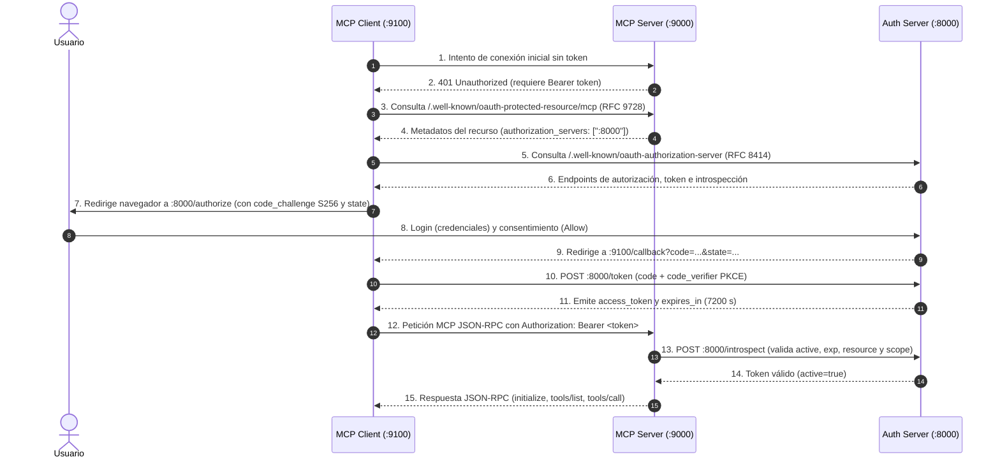

# OAuth 2.0 con Model Context Protocol (MCP)

Este proyecto es un desarrollo simple para cómo integrar **OAuth 2.0 con Model Context Protocol (MCP)**. 
> Este proyecto **NO** está diseñado ni preparado para entornos de producción. El servidor de autenticación y los clientes almacenan sesiones, usuarios y tokens en memoria por simplicidad.

El repositorio incluye dos formas de implementar tanto el servidor como el cliente MCP:
1. **Sin SDK (`no_sdk`)**: Implementado en FastAPI directo con JSON-RPC 2.0 puro y llamadas HTTP manuales para entender el protocolo y el flujo OAuth a bajo nivel.
2. **Con SDK (`sdk`)**: Implementado utilizando el SDK oficial de Python (`mcp`), mostrando cómo las abstracciones oficiales (`MCPServer`, `OAuthClientProvider`, `streamable_http_client`) resuelven el ciclo de vida de manera transparente.

---

## Arquitectura y Puertos

El sistema está compuesto por tres componentes que interactúan entre sí:

| Componente | Rol OAuth 2.0 | Puerto | Descripción |
| :--- | :--- | :---: | :--- |
| **`auth_server`** | Authorization Server | `8000` | Emite códigos y Bearer tokens, gestiona login/consentimiento e introspección. |
| **`mcp_server`** | Resource Server | `9000` | Expone herramientas MCP y valida tokens entrantes. |
| **`mcp_client`** | Client Application | `9100` | Inicia el flujo, recibe el callback y consume el servidor MCP. |

---

## Flujo OAuth 2.0 en MCP (Paso a Paso)



### Datos Intercambiados y Decisiones de Diseño

1. **Autodescubrimiento Dinámico (RFC 9728 + RFC 8414)**:
   - El cliente **no tiene hardcodeada la URL del servidor de autorización**. Solo conoce el endpoint del servidor MCP (`http://localhost:9000/mcp/`).
   - El servidor MCP anuncia dinámicamente quién es su servidor de autorización mediante los metadatos de recurso protegido (`/.well-known/oauth-protected-resource/mcp`).
2. **Seguridad PKCE (RFC 7636)**:
   - Se utiliza `code_challenge_method=S256` con `code_verifier` criptográfico (`secrets.token_urlsafe(32)`) para evitar ataques de intercepción de código de autorización.
3. **Validación de Recurso y Ámbitos (Resource Indicators RFC 8707)**:
   - El servidor MCP verifica que el token haya sido emitido específicamente para su URI (`http://localhost:9000/mcp/`) y que contenga el scope requerido (`profile`).

---

## Catálogo de Herramientas MCP (Tools)

El servidor MCP expone la siguiente herramienta de ejemplo:

* **`add`**: Suma dos números enteros o flotantes.
  * **Parámetros**:
    * `a` (number, obligatorio): Primer número.
    * `b` (number, obligatorio): Segundo número.
  * **Resultado**: Objeto de contenido de texto con el resultado de la suma.

---

## Instalación y Configuración

El proyecto utiliza **[uv](https://github.com/astral-sh/uv)** como gestor rápido de dependencias y entornos virtuales en Python.

1. **Clonar el repositorio**:
   ```bash
   git clone <url-del-repositorio>
   cd "mcp oauth 2.0"
   ```

2. **Crear y sincronizar el entorno virtual**:
   ```bash
   uv sync
   ```

---

## Guía de Ejecución

Para probar el flujo, abre **3 terminales** independientes desde la carpeta raíz del proyecto (o accediendo a `oauth-mcp`).

### Terminal 1: Servidor de Autorización OAuth (Puerto 8000)

```bash
cd oauth-mcp
uv run uvicorn auth_server.main:app --port 8000 --reload
```
* **Credenciales de prueba para login**:
  * **Email**: `juan@example.com`
  * **Password**: `password`

---

### Terminal 2: Servidor MCP (Puerto 9000)

Elige **una** de las dos implementaciones disponibles:

* **Opción A (Sin SDK)**:
  ```bash
  cd oauth-mcp
  uv run uvicorn mcp_server.no_sdk.main:app --port 9000 --reload
  ```

* **Opción B (Con SDK oficial)**:
  ```bash
  cd oauth-mcp
  uv run uvicorn mcp_server.sdk.main:app --port 9000 --reload
  ```

---

### Terminal 3: Cliente MCP (Puerto 9100)

Elige la implementación correspondiente a tu prueba:

* **Opción A (Sin SDK - Servidor web interactivo)**:
  ```bash
  cd oauth-mcp
  uv run uvicorn mcp_client.no_sdk.main:app --port 9100 --reload
  ```
  Una vez iniciado:
  1. Abre el navegador en `http://localhost:9100/login` para iniciar el flujo.
  2. Inicia sesión con `juan@example.com` / `password` y pulsa **Allow**.
  3. Serás redirigido a `http://localhost:9100/callback` mostrando el token obtenido.
  4. Prueba el recurso protegido en `http://localhost:9100/call-profile`.
  5. Ejecuta las llamadas MCP (initialize, listado y suma) en `http://localhost:9100/mcp-test`.

* **Opción B (Con SDK oficial - CLI automatizado)**:
  *El cliente con SDK ya arranca Uvicorn internamente para capturar el callback en el puerto 9100, por lo que se ejecuta directamente con `uv run`:*
  ```bash
  cd oauth-mcp
  uv run python -m mcp_client.sdk.main
  ```
  1. Abrirá automáticamente el navegador en la URL de autorización.
  2. Haz login y consiente la autorización.
  3. El cliente capturará el callback, negociará la sesión MCP sobre HTTP Streamable, listará las herramientas y ejecutará automáticamente `add(10, 20)`.
